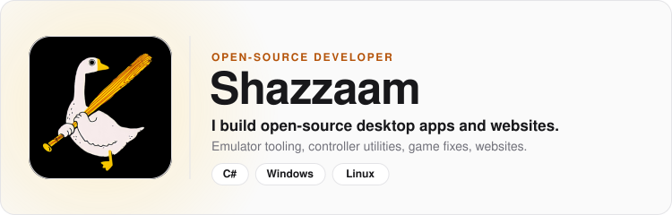
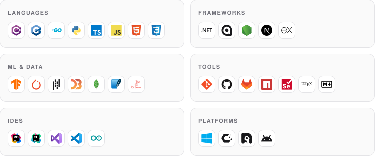

<!-- Generated by scripts/build_profile.py from assets/profile/profile.json. Edit those files and re-run the script; changes made here are overwritten. -->

  <picture>
    <source media="(prefers-color-scheme: dark)" srcset="assets/profile/hero-dark.svg">
    
  </picture>

  <a href="https://ko-fi.com/shazzaam"><picture>
    <source media="(prefers-color-scheme: dark)" srcset="assets/profile/badge-0-dark.svg">
    
  </picture></a>
  <a href="https://github.com/sponsors/shazzaam7"><picture>
    <source media="(prefers-color-scheme: dark)" srcset="assets/profile/badge-1-dark.svg">
    
  </picture></a>

  <picture>
    <source media="(prefers-color-scheme: dark)" srcset="assets/profile/title-stack-dark.svg">
    
  </picture>

  <picture>
    <source media="(prefers-color-scheme: dark)" srcset="assets/profile/stack-dark.svg">
    
  </picture>

  <picture>
    <source media="(prefers-color-scheme: dark)" srcset="assets/profile/title-projects-dark.svg">
    
  </picture>

  <a href="https://xenia-manager.github.io"><picture>
    <source media="(prefers-color-scheme: dark)" srcset="https://shieldcn.dev/header/surface.svg?title=Xenia+Manager&amp;subtitle=Makes+using+the+Xenia+emulator+easier%0AC%23%2C+AvaloniaUI%2C+Python%2C+TypeScript&amp;logo=ri%3AFaXbox&amp;mode=dark">
    
  </picture></a>

  <a href="https://github.com/xenia-manager/xenia-manager"><picture>
    <source media="(prefers-color-scheme: dark)" srcset="https://github-stats-extended.vercel.app/api/pin?username=shazzaam7&amp;repo=xenia-manager/xenia-manager&amp;show_owner=true&amp;border_radius=12&amp;description_lines_count=2&amp;card_width=400&amp;theme=dark">
    
  </picture></a>

  <a href="https://github.com/xenia-manager/optimized-settings"><picture>
    <source media="(prefers-color-scheme: dark)" srcset="https://github-stats-extended.vercel.app/api/pin?username=shazzaam7&amp;repo=xenia-manager/optimized-settings&amp;show_owner=true&amp;border_radius=12&amp;description_lines_count=2&amp;card_width=400&amp;theme=dark">
    
  </picture></a>
  <a href="https://github.com/xenia-manager/database"><picture>
    <source media="(prefers-color-scheme: dark)" srcset="https://github-stats-extended.vercel.app/api/pin?username=shazzaam7&amp;repo=xenia-manager/database&amp;show_owner=true&amp;border_radius=12&amp;description_lines_count=2&amp;card_width=400&amp;theme=dark">
    
  </picture></a>

  <a href="https://github.com/xenia-manager/x360db"><picture>
    <source media="(prefers-color-scheme: dark)" srcset="https://github-stats-extended.vercel.app/api/pin?username=shazzaam7&amp;repo=xenia-manager/x360db&amp;show_owner=true&amp;border_radius=12&amp;description_lines_count=2&amp;card_width=400&amp;theme=dark">
    
  </picture></a>
  <a href="https://github.com/xenia-manager/wiki"><picture>
    <source media="(prefers-color-scheme: dark)" srcset="https://github-stats-extended.vercel.app/api/pin?username=shazzaam7&amp;repo=xenia-manager/wiki&amp;show_owner=true&amp;border_radius=12&amp;description_lines_count=2&amp;card_width=400&amp;theme=dark">
    
  </picture></a>

  <a href="https://github.com/xenia-manager/xenia-manager.github.io"><picture>
    <source media="(prefers-color-scheme: dark)" srcset="https://github-stats-extended.vercel.app/api/pin?username=shazzaam7&amp;repo=xenia-manager/xenia-manager.github.io&amp;show_owner=true&amp;border_radius=12&amp;description_lines_count=2&amp;card_width=400&amp;theme=dark">
    
  </picture></a>

  <a href="https://github.com/DualSenseClient"><picture>
    <source media="(prefers-color-scheme: dark)" srcset="https://shieldcn.dev/header/surface.svg?title=DualSenseClient&amp;subtitle=Full+DualSense+experience+on+Windows+and+Linux%0AC%23%2C+Avalonia&amp;logo=ri%3AFaPlaystation&amp;mode=dark">
    
  </picture></a>

  <a href="https://github.com/DualSenseClient/DualSenseClient"><picture>
    <source media="(prefers-color-scheme: dark)" srcset="https://github-stats-extended.vercel.app/api/pin?username=shazzaam7&amp;repo=DualSenseClient/DualSenseClient&amp;show_owner=true&amp;border_radius=12&amp;description_lines_count=2&amp;card_width=400&amp;theme=dark">
    
  </picture></a>

  <a href="https://github.com/DualSenseClient/VIIPER"><picture>
    <source media="(prefers-color-scheme: dark)" srcset="https://github-stats-extended.vercel.app/api/pin?username=shazzaam7&amp;repo=DualSenseClient/VIIPER&amp;show_owner=true&amp;border_radius=12&amp;description_lines_count=2&amp;card_width=400&amp;theme=dark">
    
  </picture></a>

  <a href="https://www.nexusmods.com/assassinscreed/mods/32"><picture>
    <source media="(prefers-color-scheme: dark)" srcset="https://shieldcn.dev/header/surface.svg?title=Animus+Reforged&amp;subtitle=Community-edition+remaster+of+Assassin%27s+Creed+1%0AC%2B%2B%2C+C%23%2C+AvaloniaUI&amp;logo=ubisoft&amp;mode=dark">
    
  </picture></a>

  <a href="https://github.com/animus-reforged/animus-reforged"><picture>
    <source media="(prefers-color-scheme: dark)" srcset="https://github-stats-extended.vercel.app/api/pin?username=shazzaam7&amp;repo=animus-reforged/animus-reforged&amp;show_owner=true&amp;border_radius=12&amp;description_lines_count=2&amp;card_width=400&amp;theme=dark">
    
  </picture></a>

  <a href="https://github.com/animus-reforged/AltairFix"><picture>
    <source media="(prefers-color-scheme: dark)" srcset="https://github-stats-extended.vercel.app/api/pin?username=shazzaam7&amp;repo=animus-reforged/AltairFix&amp;show_owner=true&amp;border_radius=12&amp;description_lines_count=2&amp;card_width=400&amp;theme=dark">
    
  </picture></a>

